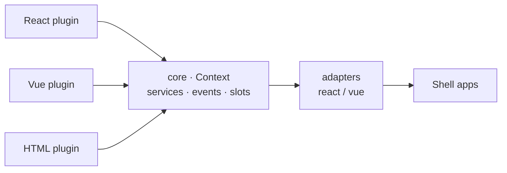

**English** | [简体中文](README.zh-CN.md)

# PlugX

**A Cordis-inspired cross-framework UI plugin platform — the app is a power strip, features are plugs, and a plug written in any framework fits.**

Service container, typed events (emit / waterfall / bail / parallel / serial), and reversible side effects — letting React, Vue and vanilla components coexist in one app through stable contracts.

## Principles

- **Everything is a plugin**: a new feature = a new plugin file, zero edits to existing code
- **Cross-framework**: React / Vue / vanilla components coexist via renderer adapters, talking only through the event bus
- **Contracts rule**: services, events and slots are all registered; humans and AI collaborate against the same registry
- **Blueprint-driven** (P2 in progress): pages assembled from JSON blueprints, paving the way for a low-code designer

## Repositories

| Repo | Description |
|---|---|
| [plugx](https://github.com/plugx-io/plugx) | Main repo: kernel, framework adapters, schema, playground, docs |

## Status

🚧 P1 (plugin runtime kernel) done, P2 (blueprint-driven) in progress. Watching welcome; PRs not accepted yet.
