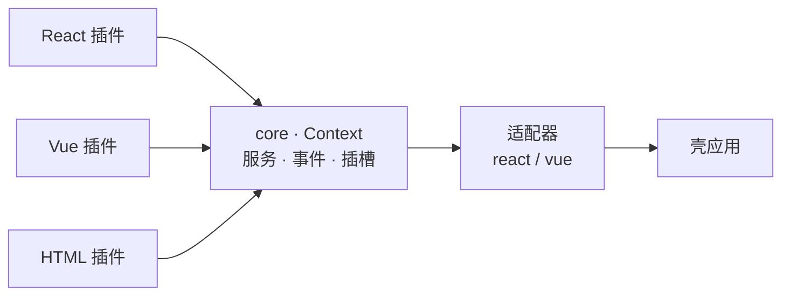

[English](README.md) | **简体中文**

# PlugX

**Cordis 思想的跨框架 UI 插件平台 —— 项目是插线板，功能是插头，什么框架写的插头都能插。**

A Cordis-inspired cross-framework UI plugin platform: service container, typed events (emit / waterfall / bail / parallel / serial), and reversible side effects — letting React, Vue and vanilla components coexist in one app through stable contracts.

## 核心理念

- **插件即功能**：新增功能 = 新增一个插件文件，不碰存量代码
- **跨框架**：React / Vue / 原生组件通过渲染器适配器共存，组件间只走事件总线
- **契约为王**：服务、事件、插槽全部登记在案，AI 与人按同一份契约协作
- **图纸驱动**（P2 进行中）：页面由 JSON 图纸装配，为低代码设计器铺路

## 仓库

| 仓库 | 说明 |
|---|---|
| [plugx](https://github.com/plugx-io/plugx) | 主仓库：内核、框架适配器、Schema、验证场、文档 |

## 状态

🚧 P1 阶段（插件化内核）已完成，P2（图纸驱动）进行中。欢迎围观，暂不接受 PR。
